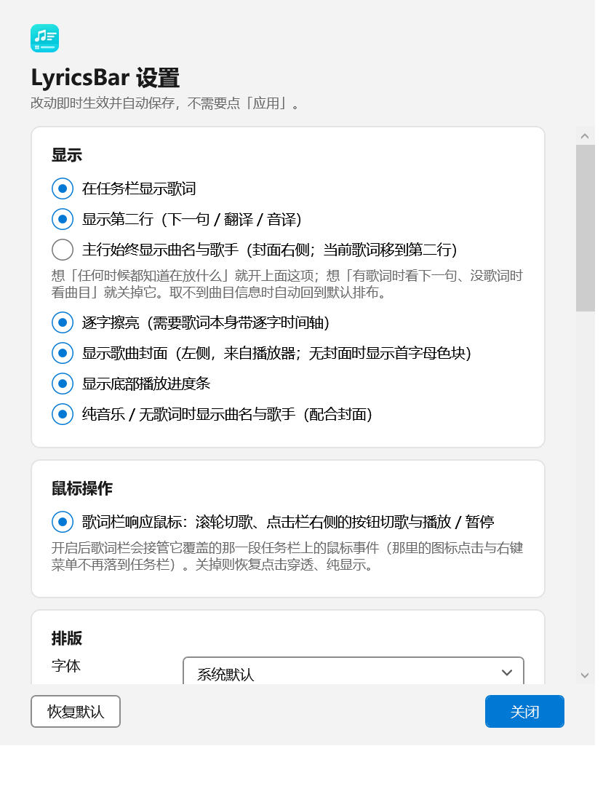

<p align="center">
  
</p>

<p align="center">
  <a href="https://github.com/me1nky1225/LyricsBar/releases"></a>
  <a href="https://github.com/me1nky1225/LyricsBar/releases"></a>
  <a href="LICENSE"></a>
  <a href="https://github.com/me1nky1225/LyricsBar/stargazers"></a>
  
  
</p>

<p align="center">
  <a href="#下载与安装">下载与安装</a> ·
  <a href="#功能">功能</a> ·
  <a href="#使用">使用</a> ·
  <a href="#常见问题">常见问题</a> ·
  <a href="#播放位置是怎么来的">播放位置</a> ·
  <a href="#从源码构建">从源码构建</a> ·
  <a href="https://github.com/me1nky1225/LyricsBar/issues/new">报告问题</a>
</p>

**LyricsBar** 把当前播放歌曲的歌词贴在 Windows 任务栏上，逐字跟唱。

它只做这一件事，所以很轻：从系统媒体会话（SMTC）读播放器正在放什么，五个歌词源并发检索，歌词由程序自己绘制——
没有内嵌浏览器、没有额外进程，单文件免安装，双击就跑。

音频控制、频谱、性能组件、音量控制、多平台、多语言、自动更新一概没有，只保留上一首 / 下一首与播放 / 暂停。

本项目是 [AF Media Bar](https://github.com/Fervent-Tempo/AF-Media-Bar)（MIT）的衍生作品：歌词取词与解析链路来自上游，
界面与渲染层改成了原生 WPF 自绘，详见 [与原项目的关系](#与原项目的关系)。当前版本 **1.6.1**，版本历史见 [CHANGELOG.md](CHANGELOG.md)。

---

## 界面

<p align="center">
  
  <br>
  <em>默认：左侧封面，中间曲名与歌手，右侧两行歌词（原文 + 译文）</em>
</p>

<p align="center">
  
  <br>
  <em>指针停在歌词上：只糊歌词这一块</em>
</p>

<p align="center">
  
  <br>
  <em>指针停在封面 / 曲目信息上：只糊这一块，歌词保持清晰（栏内还会浮出「鼠标滚轮上下曲」提示）</em>
</p>

设置窗口是 Win11 风格的单页卡片界面，改动即时生效：

<p align="center">
  
</p>

---

## 功能

### 歌词

- **逐字擦亮**：歌词带逐字（音节）时间轴时（网易云 YRC、QQ 音乐 QRC、LYS）按字推进，扫描头跟着唱到的字走
- **行级歌词也逐字推算**：只有行级时间轴（LRC）时，按整行时长平均推算一个擦亮过程（每字按 0.22 秒估算、最少 0.9 秒，
  取整行窗口与估算值的较小者）；长尾句（间奏、拖长尾音）在估算时长走完后保持全亮，不让扫描头慢慢爬。
  所以「有的歌擦亮、有的不擦亮」不再出现，区别只剩「逐字」与「按整行推算」
- **双行显示**：第二行按「第二行优先」取（默认「翻译 → 音译 → 下一句」，另有两种预设）
- **繁简转换**：不转换 / 简体 → 繁体 / 繁体 → 简体
- **纯音乐、无歌词时保留歌词栏**：把曲名与歌手顶到歌词行的位置（配合封面），不会先闪没再出现
- **前奏不留白**：位置早于第一句时显示第一句，十几秒的前奏不会让整条栏空着
- 可选**底部播放进度条**；拿不到时长时改用歌词最后一行的结束时间当刻度

### 播放位置

- 默认读系统媒体会话上报的位置，**任何走系统媒体控制的播放器都能用**（QQ 音乐、酷狗、Spotify、浏览器等）
- **网易云音乐额外有专用通道**：它的系统接口上报的位置恒为 0，还时不时塌回开头，所以本程序**只读地**读它进程里
  那个真实位置（v1.4.8 起优先用特征码定位播放器自己的字段，读不到才退回只读内存扫描），于是
  **拖动进度条、暂停、随机切歌都会同步**
- 三条位置来源（播放器自己的字段 / 播放器上报的系统时间轴 / 本地计时）互相印证，另有分层保护：
  行号与擦亮位置不回退（选行迟滞）、内存通道失效自动作废重扫、锁到全局计时器时拒绝采用、真实通道缺席太久就冻结
- 托盘菜单提供三项**手动同步**：回到本首歌开头 / 快退 10 秒 / 快进 10 秒（通道读不到时兜底，原理见
  [播放位置是怎么来的](#播放位置是怎么来的)）

### 取词

- **五个来源并发检索**：网易云音乐 / QQ 音乐 / 酷狗音乐 / 汽水音乐 / LRCLIB，按匹配分选最优
- **匹配严格度**三档（宽松 / 适中 / 严格）；不勾选任何来源 = 不联网取词
- **网易云按 id 精确取词**：只读它的播放队列文件，按「曲名（含别名）归一化后完全相等 **且歌手对得上**」反查歌曲 id，
  命中即精确取词——同名曲不再张冠李戴；歌手对不上时一律不给 id，退回搜索
- 解析 LRC / YRC / QRC / LYS，支持逐字（音节）同步
- 本地缓存：换歌取词、同一首歌不重复取

### 外观

- **歌曲封面**（取自播放器上报的封面；无封面时退化为曲名首字母色块）
- **曲目信息块**：封面右侧显示曲名与歌手，歌词在它右侧；取不到时整块自动收起，不占宽度
- **曲目信息块宽度可调**：0 = 自适应（按曲名 / 歌手里更长的那行量出来，上限 160 DIP），或给个 40–400 DIP 的固定值——
  固定后整条栏不会因为两首歌曲名长短差很多而忽宽忽窄
- **歌词字体可选**：下拉列常用的 15 款（雅黑 / 等线 / 宋体 / 楷体 / 黑体 / Segoe UI / Arial / Times New Roman / Consolas 等），
  仍可直接输入清单外的字体名；另有**加粗**与**斜体**两个开关
- **文字颜色**：一排常用色块（纯白 / 暖白 / 淡金 / 天蓝 / 湖绿 / 樱粉 / 浅紫 / 浅灰 / 深灰）点一下即用，
  也可填任意 `#RRGGBB` 或颜色名（如 `White`、`#FFE082`）
- **曲目信息可以完全独立**（v1.6.0）：曲名 / 歌手那一块有自己的一套字体（默认「跟随歌词字体」，也可单独选一款）、
  加粗、斜体、字号 %（50–200）与文字颜色（留空 = 跟随歌词颜色），歌词那一套完全不受影响
- 字号、字距 %、行距 %、未唱不透明度 %、文字对比阴影
- **对齐**：左 / 居中 / 右 / 左右分离（两行仍上下排，主行靠左、第二行推到最右）
- **停靠位置**：靠左 / 居中 / 靠右 + 偏移量微调；另有「使用固定栏宽」与固定宽度 / 最大宽度

### 鼠标操作（默认开启，可关）

- **指针压在歌词上**：三枚控制按钮（上一首 / 播放暂停 / 下一首）浮在歌词上方一块磨砂底板上，播放器不支持的能力置灰。
  按钮只认歌词这一块——指针停在封面 / 曲目信息上时不会出现，那里只有「鼠标滚轮上下曲」的提示
- **单击歌词栏**（按钮之外的任何位置）= 打开正在放歌的那个播放器（v1.6.0）。播放器缩在任务栏里、或者已经
  「关闭到系统托盘」也能叫出来（v1.6.1 起找的是播放器的窗口，不是它的主窗口句柄）
- **分区磨砂**（v1.5.0）：歌词栏分成「封面 + 曲目信息」与「歌词」两块，**指针压在哪一块就只糊哪一块**，另一块保持清晰
- **滚轮**上 / 下 = 上一首 / 下一首（任何时候都能用）
- 需要让鼠标点击继续落到任务栏时，在设置里关掉「鼠标操作」，恢复点击穿透

### 轻量

- **单文件、免安装**：一个约 178MB 的 exe 自带 .NET 10 运行时，解压到任意可写目录双击即用
- **原生渲染**：歌词由程序自己绘制，不内嵌浏览器、不起 `msedgewebview2` 子进程，只有一个 `LyricsBar.exe` 进程
  （设置里仍可切回网页引擎对拍观感或兜底，那条路会额外拉起一整套浏览器子进程）
- **内存**（任务管理器的「内存」，即私有工作集）：原生渲染下播放中约 57MB、空闲约 28MB（v1.4.0 之前是 155MB 上下
  加一整套浏览器子进程）；v1.5.1 把网易云特征码通道附加时那次「整段读 25.9MB `.text`」改成 4MB 缓冲流式扫描，
  那一档从约 55MB 降到约 8MB
- 程序**闲置超过 1 分钟且没有在播放**时，会把闲置工作集交还操作系统

### 隐私

全部在本机完成：只把「曲名 + 歌手」发给歌词平台用于取词，不采集、不上报任何使用数据。
网易云位置通道是**只读**的——用 `PROCESS_VM_READ` 读播放器自己的字段或扫内存，不写入、不注入、不改动网易云的任何数据。

---

## 下载与安装

1. 打开 [Releases](https://github.com/me1nky1225/LyricsBar/releases)，下载最新版的 `LyricsBar.exe`
2. 放到任意**可写**目录（例如 `D:\Tools\LyricsBar\`），双击运行

**系统要求**：Windows 10 1809 或更新的 x64 系统（含 Windows 11）。发布包自带 .NET 10 运行时，不需要另外装 .NET；
默认的渲染路径**不需要 Microsoft Edge WebView2 Runtime**（只有把设置里的「歌词渲染」切回「网页（WebView2）」时才需要）。

首次运行**不会显示主窗口**：任务栏上出现歌词栏，托盘出现一个音符图标。托盘图标**左键单击打开设置**，右键打开菜单。

> 发布包未签名，Windows 会提示「未知发布者」，选择「仍要运行」即可。

**升级**：托盘菜单「退出」后，用新版的 `LyricsBar.exe` 覆盖旧的即可。设置与日志都在 `%LOCALAPPDATA%\LyricsBar\`，不会丢。

---

## 使用

### 托盘菜单

| 菜单项 | 作用 |
|---|---|
| 显示歌词 | 开关歌词栏（勾掉后只剩下托盘图标） |
| 设置… | 打开单页设置窗口（左键单击托盘图标也是这个） |
| 重新停靠到任务栏 | 换了分辨率、缩放、任务栏位置或多显示器之后点一下 |
| 歌词同步：回到本首歌开头 | 播放器不上报时间轴时手动把歌词时间推回（网易云等） |
| 歌词快退 10 秒 / 歌词快进 10 秒 | 同上，微调 10 秒 |
| 打开日志 | 打开 `%LOCALAPPDATA%\LyricsBar\lyricsbar.log` |
| 退出 | 关闭程序 |

### 歌词栏上的鼠标

- **指针压在歌词上**：控制按钮浮出，可直接上一首 / 播放暂停 / 下一首
- **单击**（按钮之外）：把正在放歌的播放器叫到前台（v1.6.0）
- **滚轮**：上滚上一首、下滚下一首（不用移入也能用）
- **指针压在哪一块就只糊哪一块**：压在封面上糊「封面 + 曲目信息」，压在歌词上糊歌词
- 关掉「鼠标操作」后恢复点击穿透，歌词栏纯显示、不拦任务栏的点击

### 设置窗口

单页卡片式，**改动即时生效并自动保存，不需要点「应用」**；左下角「恢复默认」可一键还原。速查：

| 分组 | 能改什么 |
|---|---|
| 显示 | 是否显示歌词栏、第二行、曲目信息块、封面、进度条；曲目信息块宽度；逐字擦亮；纯音乐时是否占用歌词行 |
| 鼠标操作 | 是否响应鼠标（滚轮切歌、歌词区悬停显示按钮、单击打开播放器） |
| 排版 | 字体、加粗、斜体、字号、字距 %、行距 %、未唱不透明度 %、第二行优先、对齐方式（左 / 居中 / 右 / 左右分离）、中文转换（简繁） |
| 曲目信息 | 曲目信息的字体（跟随歌词 / 单独指定）、加粗、斜体、字号 %、文字颜色（v1.6.0，与歌词分开） |
| 宽度与位置 | 停靠位置（靠左 / 居中 / 靠右）、位置偏移 (DIP)、是否使用固定栏宽、固定宽度 / 最大宽度 (DIP) |
| 外观 | 文字颜色（色块或手填）、对比阴影 |
| 歌词来源 | 五个来源的开关、匹配严格度 |
| 其它 | 歌词渲染引擎（原生 / 网页）、强制软件渲染、兼容模式、重新停靠、打开设置文件夹 |

### 歌词栏宽与位置

栏宽默认**跟着歌词内容自动伸缩**，可以用「使用固定栏宽」钉死。「位置偏移」在三种停靠方式下含义略有不同：

| 停靠 | 偏移量的含义 | 例子（任务栏宽 2560px，歌词栏宽 180px，150% 缩放） |
|---|---|---|
| 靠左 | 距任务栏左边缘的间距 | 偏移 0 → 左边界 0px；偏移 120 DIP → 左边界 180px |
| 居中 | 在正中基础上的左右平移 | 偏移 0 → 左边界 1190px；偏移 120 DIP → 左边界 1370px |
| 靠右 | 距任务栏右边缘的间距 | 偏移 0 → 左边界 2380px；偏移 120 DIP → 左边界 2080px |

偏移量单位是 DIP，会按显示器缩放换算成物理像素（上表是 150% 缩放，120 DIP = 180px）。
三种方式都会把结果夹在任务栏范围内，偏移量再大也不会把歌词栏推出屏幕。

**任务栏在屏幕左侧或右侧时**（v1.6.1）：歌词栏自动转成竖排——宽度变成任务栏的厚度，长度沿竖直方向，
文字从下往上读，进度条贴在竖条靠屏幕内侧的那条边。上表三种停靠方式照旧，只是"左边界"换成"上边界"、
沿竖直方向生效；曲目信息块在上面、歌词在下面（相对文字方向仍是"左 / 右"）。

---

## 常见问题

**歌词栏没出现 / 一片空白？**
先确认托盘菜单里「显示歌词」是勾上的，并且**真的有一首歌在播放**（没有媒体在播放时歌词栏是隐藏的）。
还不行就跑一次自检（见下一节），重点看 `投影结果: IsVisible=...` 与 `位置推进检查`。

**取不到歌词 / 取串了？**
先看设置的「歌词来源」是否勾选了来源（一个都不勾 = 不联网取词）。用网易云音乐时建议把「匹配严格度」设为「适中」或「严格」——
程序会尝试从网易云本地播放队列读到精确歌曲 id，命中就是精确取词；同名曲的误配主要靠这条路径避免。
也可以在自检里指定曲目试一次：`LyricsBar.exe --diagnose "晴天" "周杰伦"`。

**有的歌逐字擦亮，有的不逐字？擦亮会跳回开头？**
网易云只对**一部分曲目**提供逐字时间轴（YRC/QRC），其余只有行级时间轴（LRC）。两种现在都会擦亮：前者按字，后者按整行推算。
日志里的 `行切换` 会写明这一句是逐字还是行级；若出现 `擦亮倒退: …`（同一行内进度回退，画面上就是扫描头跳回开头），
那是异常，请把这行连同前后几十行日志一起留档反馈。

**网易云的进度对不上？**
网易云的系统接口不上报真实进度，程序改为只读它的进程内存来跟随（见 [播放位置是怎么来的](#播放位置是怎么来的)）。
若日志里显示特征码失配或内存通道读不到，程序会**静默退回本地计时**（歌词仍在，只是拖过进度条后需要手动推回），
此时用托盘菜单的三项「歌词同步」推回即可。

**歌词栏压在任务栏图标上、点不到图标？**
歌词栏的位置由「停靠位置 + 偏移量」决定，**不跟随任务栏图标避让**。用偏移量把它挪开，或者在设置里关掉「鼠标操作」
让点击穿透到任务栏。

**单击歌词栏没有打开播放器？**
程序拿系统媒体会话给的来源标识去找播放器进程（v1.6.0）：网易云、QQ 音乐、酷狗、汽水、Spotify、浏览器这类都在列表里，
但改过 exe 名、或是把播放器装在很奇怪的地方时可能认不出来。日志里搜 `单击歌词栏` 会写明它试了哪个进程名；
认不出来的话这一下就当没点，其它功能（按钮、滚轮、托盘菜单）都不受影响。

**换了分辨率 / 缩放 / 插了副屏之后位置不对？**
托盘菜单点一下「重新停靠到任务栏」。

**后台占用有点高？**
原生渲染下播放中约 57MB、空闲约 28MB（任务管理器的「内存」）。程序闲置超过 1 分钟且没在播放时会把闲置工作集交还系统。
设置里若把「歌词渲染」切成了网页（WebView2），会多出一整套 `msedgewebview2` 子进程，那是内存高得多的那条路。

**支持哪些播放器？**
任何走系统媒体控制（SMTC）的播放器都能用。网易云音乐额外有专用位置通道，跟随拖动最完整。

**有别的语言界面吗？**
目前只有简体中文（原项目支持四种语言）。

---

## 播放位置是怎么来的

这一节解释「歌词为什么会跟得上、偶尔又为什么会慢半拍」。只想用的话可以跳过。

### 问题

**网易云音乐的 SMTC 时间轴不但恒零，还会周期性「塌回开头」**——Start / End / Position / MinSeek / MaxSeek 大多是 0，
`LastUpdatedTime` 是 1601-01-01；真机日志里它还会时不时上报一个 0–1.5 秒的假位置（同一时刻内存里读到的是 288 秒）。
所以位置不能「播放器说什么就信什么」。

### 三条来源

| 来源 | 说明 |
|---|---|
| 播放器自己的字段（v1.4.8） | 用两条特征码在 `cloudmusic.dll` 的代码段里定位播放器对象与调度器，**直接读出**位置 / 时长 / 播放状态 / 歌曲 id，100 毫秒一拍 |
| 只读内存扫描（v1.3.3，现为后备） | 只读地扫它进程内存里那簇「每秒 +1」的浮点数，三遍筛选锁定，之后每 400 毫秒读一次 |
| 本地计时 | 换歌或暂停时按本机时钟推进，最后兜底 |

两个真实通道都是**只读**的（`PROCESS_VM_READ`）：不写入、不注入、不改动网易云的任何数据。能正常上报时间轴的播放器
（QQ 音乐、酷狗、Spotify、浏览器等）直接采用系统上报的位置，不受这一节影响。

### 仲裁（v1.4.5）

| 情况 | 采用谁 | 为什么 |
|---|---|---|
| 内存与上报值相差 ≤ 3 秒 | 上报值 | 一致时用上报值，它带真实采样时刻，外推更准 |
| 内存与上报值相差 > 3 秒 | **内存值** | 内存是从播放器进程里直接读的，上报值只是聚合层的转述 |
| 只有上报值，且「上一拍 > 5 秒而这一拍 ≤ 5 秒」 | 先按本地计时顶住，同一落点连续 3 拍才承认真实跳转 | 脏值通常只出现一拍，真实拖动会一直停在那里 |
| 只有上报值，向前跳 / 不是塌回形状的向后跳 | 上报值，立即采纳 | 那是用户自己拖的 |
| 两条都没有 | 本地计时 | 最后的兜底 |

代价：真的把进度拖回开头时，画面最多滞后约 0.75 秒（3 拍）才跟上。

### 分层保护（v1.4.5–v1.4.9）

| 异常 | 保护 | 你会看到 |
|---|---|---|
| 位置偶尔抖动或短暂回退（v1.4.9） | 选行迟滞：行号与擦亮位置都不回退，真回拖（退到行首前超过 0.6 秒）才让路 | 歌词不再往回跳，擦亮只向前推进 |
| 特征码在当前 `cloudmusic.dll` 上失配（v1.4.8） | 自动退回内存扫描通道 | 日志一行「未命中…退回内存扫描通道」 |
| 上报值周期性塌回 0–1.5 秒（v1.4.5） | 三条通道互相印证；塌回开头的向后跳要连续 3 拍才认 | 歌词不再被拽回第一行再追回来 |
| 内存锁定后推进速度与本地计时长期不符（v1.4.6） | 10 秒窗口内推进量之差持续超 5 秒即作废重扫 | 日志一行「内存通道已失效」，随后重新锁定 |
| 内存锁到全局计时器：位置变成几千秒、换歌不归零（v1.4.7） | 新锁定必须与本地计时相差 ≤900 秒；换歌后 3 秒内必须归零，否则拒绝采用 | 日志一行「未通过健全性检查」，改由本地计时接手 |
| 两条真实通道同时缺席，本地计时顶替超 30 秒（v1.4.6） | 冻结播放位置，等通道恢复 | 歌词停在某一行，通道恢复后自动接着走 |

后两项保护只对内存扫描通道有效，特征码通道工作时会刻意跳过——它读的是播放器自己的字段，中途开始播放时位置本来就与
本地计时差一大截，硬套会把正确值判成垃圾。正常播放下这些保护都不会触发。

### 边界

- 退回本地计时的那几秒（换歌后重新锁定约 6 秒，或通道读不到时），「启动时已播一半 / 拖过进度条」这两种情况会短暂出现，
  可用托盘菜单的三项「歌词同步」手动推回。内存通道在位时这三项点了不会有反应（位置每几百毫秒就被真实值覆盖），
  它们只是读不到时的兜底
- 特征码依赖上游那两条特征码与固定偏移，网易云升级换了代码就可能失配；失配时打一行日志自动退回内存通道，
  两条都失效时静默退回本地计时——不会崩，也不影响其它播放器
- **进度条本身不受影响**——拿不到时长时改用歌词最后一行的结束时间当刻度

---

## 命令行自检（排查用）

程序自带命令行自检，会检查运行环境并把结果写进日志。**可以在程序运行时执行**，不需要先退出。

```bash
LyricsBar.exe --diagnose                    # 检查环境 + 取一次词，输出最终投影帧
LyricsBar.exe --diagnose "晴天" "周杰伦"     # 指定曲目试取歌词
LyricsBar.exe --no-dock                    # 不停靠进任务栏，以普通窗口运行（分离「渲染问题」与「停靠问题」）
LyricsBar.exe --render-preview             # 把每种歌词排版各画一张 PNG 到 %TEMP%\lyricsbar-preview
```

`--diagnose` 会输出：系统与 .NET 版本、WebView2 运行时版本、每一块任务栏（含 DPI 缩放）、媒体会话是否可用、
**SMTC 原始时间轴字段**、播放位置是否在推进、**网易云位置通道的锁定情况**、当前曲目、一次完整的取词结果
（来源、匹配分、格式、同步级别、行数、前 5 行与逐字片段数），以及**取词 + 投影的最终帧**
（是否可见、行下标、当前行文本、译文与翻译模式）。判断「歌词为什么不显示」看最后一项最直接。

`--render-preview` 会输出 14 张图（居中 / 左右分离 / 译文对 / 超长行水平滚动 / 字距 20% / 靠左无封面 / 截断省略号 /
纯音乐留栏 / 悬停磨砂前后 / 上滚三帧 / 信息块磨砂），改完渲染层对着图看比反复开关程序快得多。

**日志位置**：`%LOCALAPPDATA%\LyricsBar\lyricsbar.log`（超过 1MB 自动清空重写）
**设置位置**：`%LOCALAPPDATA%\LyricsBar\settings.json`

---

## 已知限制

- **任务栏在左右侧时用竖排**（v1.6.1）：整块内容旋转 90°、文字从下往上读。竖排下字号、行数都不变，
  但任务栏只有几十像素宽，长句会比横排更早触发行内滚动；多显示器时只使用主显示器任务栏
- **只有简体中文界面**
- **只提供上一首 / 下一首与播放 / 暂停控制**，不支持音量等操作；播放器未通过 SMTC 提供相应能力时按钮置灰
- **鼠标操作默认开启**，歌词栏会拦截其覆盖范围内的任务栏点击与滚轮；关掉后恢复点击穿透
- **单击打开播放器取决于能否认出那个进程**（v1.6.0）：系统媒体会话只提供控制能力、不提供"激活这个播放器"，所以只能拿
  会话的来源标识去匹配进程 / 窗口。网易云、QQ 音乐、酷狗、汽水、Spotify、Chrome 这类常见播放器都有对应；改过 exe 名字的、
  或者标识里没有可执行文件名的，点了没反应（程序会记一条日志，其它功能不受影响）
- **歌词栏不跟随任务栏图标避让**，可能压在图标上，用位置偏移躲开
- **无歌词时的曲目信息要等检索完成**；检索期间整条栏仍留在任务栏上（只剩封面），不会先闪没再出现
- **网易云位置通道**读不到时静默退回本地计时：特征码失配或换歌后重新锁定约 6 秒；此时需用托盘菜单手动同步
- **逐字擦亮取决于歌词本身**：网易云只对一部分曲目提供逐字时间轴，其余按整行推算（两者都有擦亮过程）
- **原生渲染器没有频谱场景**（上游那套「无歌词时柱子律动」从未被宿主触发，属死代码）
- **字距大于 0 时，拉丁文排版与浏览器略有差异**（WPF 没有字距属性，只能逐字排布）；默认字距 0 时走整行绘制，观感一致
- 发布包**未签名**，Windows 会提示「未知发布者」

---

## 从源码构建

需要 **.NET 10 SDK**（`global.json` 未锁定，10.0.2xx 及以上均可）。

```bash
# 调试运行
dotnet run --project src/LyricsBar/LyricsBar.csproj

# 发布单文件
dotnet publish src/LyricsBar/LyricsBar.csproj -c Release -r win-x64 --self-contained true -p:PublishSingleFile=true -o dist

# 想要小体积（约 30MB，目标机需装 .NET 10 桌面运行时）
dotnet publish src/LyricsBar/LyricsBar.csproj -c Release -r win-x64 -p:SelfContained=false -p:PublishSingleFile=true -o dist-fx
```

> 发布配置里 `EnableCompressionInSingleFile` 是**故意关掉**的，别顺手改回 `true`：它把 exe 从 178MB 压到 75MB，
> 代价是启动时整包解压进内存，常驻内存翻两三倍（155MB → 57MB 的差距主要就是它）。

## 项目结构

```
src/LyricsBar/
  Classes/Services/Lyrics/          取词、解析、匹配、缓存与投影（上游链路）
    Presentation/LyricsNativeRenderer.cs   原生歌词渲染器（自绘）
    Presentation/LyricsHoverRegionPolicy.cs 悬停分区与曲目信息宽度策略
  Classes/Services/NeteaseSignatureChannel.cs  网易云位置：特征码通道（首选）
  Classes/Interop/ProcessMemory.cs             只读进程内存读取
  Classes/Settings/                            设置模型 + 字体 / 颜色清单
  Views/                                       任务栏窗口、设置窗口
  Web/Lyrics/                                  网页渲染引擎（可选，兜底）
tools/                               探针与小工具（取词、位置、擦亮、悬停分区、播放器激活、设置往返…）
docs/                                文档、设置界面截图、README 用图
```

## 与原项目的关系

本项目是 [AF Media Bar](https://github.com/Fervent-Tempo/AF-Media-Bar)（MIT）的衍生作品，
基于 commit `917ebf4a478bfc5f981c0dfb0ef499a45ef4304f`。

**直接复用**：`Classes/Services/Lyrics/**` 歌词取词与解析全链路（约 3500 行）与 `Web/Lyrics/**` 歌词前端
（HTML/CSS/JS，约 3700 行）逐字保留；`TaskbarDockService` 的任务栏停靠 Win32 逻辑精简重写；
`LruCache` 来自 FluentFlyout（GPL-3.0-or-later）。

**对移植代码的改动**：`LyricsPresentationProjector` 位置早于首行时改为显示首行、曲目信息改由 `ResolveTrackInfoLines` 提供；
`LyricsSecondaryLinePolicy` 默认顺序改为「翻译 → 音译 → 下一句」；`LyricsWebViewRenderer` 新增 WebView2 启动参数与
崩溃降级、封面 / 曲目信息 / 磨砂浮层三条消息通道；`Web/Lyrics/**` 新增封面右侧曲目信息块、控制按钮磨砂浮层与
「左右分离」对齐。其余移植文件与上游一致。

**新写的部分**（要点）：原生歌词渲染器（`LyricsNativeRenderer`，v1.4.0）；SMTC 媒体读取与本地计时兜底、
`MediaTransportService`；网易云位置的特征码通道（v1.4.8，v1.5.1 起改为 4MB 缓冲流式扫描）与只读内存通道；
选行迟滞（`LyricLineCursor`，v1.4.9）；行级歌词的合成擦亮（`LyricHighlightPolicy`，v1.4.10）；
悬停分区与曲目信息宽度策略、字体与颜色清单（v1.5.0）；网易云按播放队列 id 精确取词（`NeteaseQueueService`）；
播放器激活（`PlayerActivationService`，v1.6.0——从会话的来源标识认进程、把窗口拉到前台，SMTC 本身没有这项能力）；
封面读取（缩到 128px 再下发）、应用图标统一加载、取词协调器、任务栏窗口尺寸计算、设置模型、托盘图标与设置窗口、
命令行自检。移植代码之外的实现不含上游代码。

**第三方依赖**：[Lyricify-Lyrics-Helper](https://github.com/WXRIW/Lyricify-Lyrics-Helper)（歌词检索与解析）、
[OpenccNetLib](https://www.nuget.org/packages/OpenccNetLib)（繁简转换）、
[F23.StringSimilarity](https://www.nuget.org/packages/F23.StringSimilarity)（元数据匹配打分）、
[Microsoft.Web.WebView2](https://www.nuget.org/packages/Microsoft.Web.WebView2)（网页引擎，默认不使用）。
完整声明见 [THIRD-PARTY-NOTICES.md](THIRD-PARTY-NOTICES.md)。

> **文档**：本文件（功能与用法）与 [CHANGELOG.md](CHANGELOG.md)（版本历史）是本仓库的用户文档；
> 依赖与来源声明见 [THIRD-PARTY-NOTICES.md](THIRD-PARTY-NOTICES.md)，许可见 [LICENSE](LICENSE)。

---

## 致谢

- [AF Media Bar](https://github.com/Fervent-Tempo/AF-Media-Bar) —— 本项目的来源，歌词取词与解析链路、歌词前端
- [Lyricify-Lyrics-Helper](https://github.com/WXRIW/Lyricify-Lyrics-Helper) —— 歌词检索与解析
- [FluentFlyout](https://github.com/unchihugo/FluentFlyout) —— `LruCache`
- [Kxnrl/NetEase-Cloud-Music-DiscordRPC](https://github.com/Kxnrl/NetEase-Cloud-Music-DiscordRPC) —— 网易云特征码的原始出处（经 AF Media Bar 转述，许可证待核实）

## 许可

MIT。沿用原项目的许可与署名；`LruCache` 来自 FluentFlyout，为 GPL-3.0-or-later。

在线取到的**歌词内容版权属于各音乐平台**，自用无碍，二次分发或商用请自行评估。
